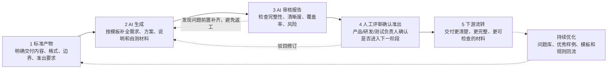

# 团队 AI 协作模型

> 目标：把研发过程标准化，让 AI 按标准产出、按标准检查；团队按统一工作方式审核和准出。

## 1. 核心目标

AI Delivery Kit 不是单点工具规范，而是一套团队协作机制：

| 目标 | 说明 |
|------|------|
| 可复制 | 每个阶段先明确交付什么、格式是什么、边界是什么 |
| 可检查 | AI 与人工都按同一套 Gate / Checklist 检查 |
| 可流转 | 下游接收的是清楚、完整、可追溯的材料 |
| 可持续优化 | 模板、审核规则、优秀样例、常见问题持续回流 |

Q3 试点核心指标：选择部分项目跑通机制，用真实项目数据验证效率提升，目标参考 **50% 效率提升验证**。

## 2. 标准化流转机制

每个阶段都遵循同一套流转：

## 3. 四阶段协作总览

| 阶段 | 标准产物 | AI 生成 | 人工审核 | 在线审核 / Gate | 准出后流向 |
|------|----------|---------|----------|------------------|------------|
| 1. 产品需求设计 | PRD、自检、需求范围、功能拆解、验收标准、边界说明 | 产品负责人用 AI 补齐 PRD 与自检 | 产品负责人审核 | R0 / R1a / R1b / G1 | 技术方案与测试方案 |
| 2. 技术方案设计 | 技术方案、影响范围、风险说明 | 研发负责人用 AI 生成方案与影响分析 | 研发负责人审核 | G2a / G2b | 编码实现 |
| 3. 编码执行 | 实施计划、代码、改动说明、自测证据、提测说明、PR Checklist | 研发用 AI 编码、生成说明与自测材料 | 研发负责人 / 代码 Owner 审核 | G3 | 测试验收 |
| 4. 验收发布 | 测试用例、测试报告、验收结论、发布计划、复盘 | 测试负责人用 AI 生成测试与发布材料 | 测试负责人 / 产品负责人审核 | G5 / G8 / G9 | 上线、归档、知识回流 |

## 4. 阶段职责

### 4.1 产品需求设计

产品负责人负责把模糊需求转为可执行输入：

- 背景与目标；
- In Scope / Out Scope；
- 用户故事、AC、边界、NFR；
- 验收标准和业务 Checklist；
- 有 UI 时页面索引；
- PRD 自检与 Fail/Partial 解释。

AI 负责补全结构、发现遗漏、生成自检建议；产品负责人负责判断内容是否真实、范围是否合理、表达是否可下游执行。

### 4.2 技术方案设计

研发负责人负责把 PRD 转为可实现方案：

- 实现方案；
- 影响范围；
- 接口、数据、兼容、迁移；
- 风险说明；
- 实施计划；
- PRD 覆盖矩阵。

AI 负责生成方案草稿、做覆盖检查、提示风险；研发负责人负责架构、边界、工期、风险和技术可行性。

### 4.3 编码执行

研发负责按已确认计划实施：

- 先 implementation-plan 后编码；
- 代码实现与改动说明；
- 自测证据；
- 提测说明；
- PR Checklist。

AI 可协助编码、重构、生成自测材料、解释改动；代码 Owner 负责最终代码质量、CI、Review 和提测准出。

### 4.4 验收发布

测试和产品负责最终质量确认：

- 测试用例；
- 测试报告；
- 验收记录；
- 发布计划；
- 回滚和监控；
- 上线复盘。

AI 负责生成测试分析、覆盖检查、风险提示、复盘草稿；测试负责人和产品负责人负责最终结论。

## 5. 平台交互原则

AI Delivery Hub 以**需求**为协作主线，产品/研发/测试在同一需求上各自维护角色产物；平台以“当前阶段工作台”组织**需求详情页**，而不是只展示底层 checkpoint 规则 ID：

| 页面元素 | 要回答的问题 |
|----------|--------------|
| 当前状态 | 现在处在哪个阶段，是否可进入下一步 |
| 下一步操作 | 当前负责人应该做什么 |
| 标准产物完整度 | 标准文档是否齐全，关键字段是否缺失 |
| AI 修订任务 | 是否需要本地 AI 补齐或修订 |
| 在线审核报告 | 有哪些 blocker/major/minor |
| 人工准出 | 谁需要审核，是否已确认 |
| 流转记录 | review run、Draft Revision、发布、归档历史 |

平台展示名称 SHOULD 使用业务语言，例如“需求审核”“方案审核”“提测审核”“验收发布”；内部可继续使用 R0、G2a、G3 等 Gate Code 作为规则 ID。

## 6. 持续优化

每次执行后都要沉淀四类资产：

| 资产 | 来源 | 用途 |
|------|------|------|
| 模板改进 | 高频缺失字段、人工补充内容 | 降低下一次补齐成本 |
| 审核规则 | Gate Findings、评审驳回原因 | 提升 AI 审核准确性 |
| 优秀样例 | 高质量 PRD、方案、测试报告 | 给 AI 和新人参考 |
| 常见问题库 | 重复 blocker/major、返工点 | 前置提醒，减少沟通拉扯 |

持续优化由 AI Champion、产品/研发/测试负责人共同维护；规则修改先进入 AI Delivery Kit，再同步到 Codex、Cursor、AI Delivery Hub 和 Gate Engine。
