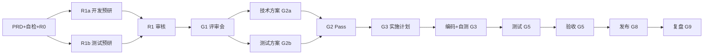

# 产研测 AI 交付门禁 · Confluence 宣贯（一页纸）

> **版本**：AI Delivery Kit **v1.0.0**（初版）  
> **Confluence**：[宣贯一页纸](https://confluence.example.com/spaces/TEAM/pages/1002/)（TEAM · 示例 ID 1002）  
> **权威源**：`ai-delivery-kit/` · [README.md](../README.md)  
> **试点清单**：[pilot-90day-checklist.md](./pilot-90day-checklist.md) · [Confluence](https://confluence.example.com/spaces/TEAM/pages/1003/)

---

## 流程一览



**铁律**：AI 出证据 → **人工 Gate 签字** → 下一关；**G3 先 plan 后编码**；**G2 覆盖 100%**；**G3 P0 100%**。

---

# 产品 · 一页纸

## 你要做什么

| 时机 | 产出 | Gate |
|------|------|------|
| 迭代初 | `PRD.md`（US/AC/BE/NFR/CL）；**Figma AI** + §11 页面索引誊写；`prd-self-check.md` 自检 | R0 |
| R1 审核 | 审 `dev-prd-review.md`、`qa-prd-review.md` | R1a/R1b |
| 评审后 | `review-minutes.md`（关闭预研 Q-xxx） | G1 |
| 测完 | `acceptance-record.md` spot check | G5 |

## Cursor 怎么说

```
按 prd-prototype-challenge skill 帮我预检 PRD（审核开发预研报告时用 dev 那份对照）
按 prompts/R0-prd-self-check.md 阅读 @PRD.md 生成 prd-self-check.md
按 delivery-gate-docs skill 生成 S0 PRD，素材：...
```

## 审核开发/测试预研报告（R1）看什么

| 检查 | 通过标准 |
|------|----------|
| 有没有认真读 | 摘要 ≥200 字且**非 PRD 复制** |
| 问题够不够 | ≥5 条，引用 US/AC/页面 |
| 问题说没说透 | 每条 Q 有问题解释、影响、改进建议 |
| 是否敷衍 | 禁止「暂无问题」 |
| 原型 | 有 UI 时 §11 页面索引非空（非仅 Figma 链接） |

**签字**：R1a 产品 · R1b 产品 + 测试负责人

---

# 开发 · 一页纸

## 你要做什么

| 时机 | 产出 | Gate | 时限 |
|------|------|------|------|
| **G1 前（强制）** | `dev-prd-review.md` AI 挑刺 PRD+原型 | R1a | R0 后 1 工作日 |
| G1 后 | `tech-design.md` + **PRD 覆盖度矩阵 100%** | G2a | 1 工作日 |
| G2 后 | `implementation-plan.md`（**先 plan 后编码**） | G3 | G2 Pass 后 |
| 提测 | `self-test-report.md` + **P0 TC 覆盖 100%** | G3 | — |

## Cursor 怎么说（复制即用）

**① 评审前挑刺 PRD（必做）**
```
按 prd-prototype-challenge skill 阅读 @PRD.md 和原型，生成 dev-prd-review.md
原型链接/描述：（粘贴）
```

**② 写技术方案**
```
按 delivery-gate-docs skill 生成 S2a 技术方案
@PRD.md @review-minutes.md @trade/
```

**③ G3 写实现计划（G2 后必做）**
```
按 prompts/G3-implementation-plan.md 生成 implementation-plan.md
@PRD.md @tech-design.md @test-plan.md
```

**④ 提测前查自测覆盖**
```
按 self-test-coverage-check skill 对照 @test-plan.md 检查 @self-test-report.md
```

## dev-prd-review 最低要求

- 标注 AI 工具 + 生成时间
- 问题 ≥5 条，编号 Q-001，引用 PRD 条目
- 每条问题说明：问题解释、影响、改进建议、是否 Block G1
- 分类：歧义 / 遗漏 / 矛盾 / 技术疑虑

## 提测最低要求

- 每个 **P0 用例** 一行：Pass + **截图/日志链接**
- P0 TC 自测覆盖率 **= 100%**
- AC 自测 Fail = 0

---

# 测试 · 一页纸

## 你要做什么

| 时机 | 产出 | Gate | 时限 |
|------|------|------|------|
| **G1 前（强制）** | `qa-prd-review.md` AI 读 PRD+原型 | R1b | R0 后 1 工作日 |
| G1 后 | `test-plan.md` + **PRD 覆盖度矩阵 100%** | G2b | 1 工作日 |
| 开发提测 | 审 `self-test-report.md` TC 覆盖 | G3 | 4h |
| 测完 | `test-report.md` | G5 | — |

## Cursor 怎么说

**① 评审前预研（必做）**
```
按 prd-prototype-challenge skill（测试视角）阅读 @PRD.md，生成 qa-prd-review.md
```

**② 写测试方案**
```
按 delivery-gate-docs skill 生成 S2b 测试方案
@PRD.md @review-minutes.md @tech-design.md
```

**③ 审开发自测（G3）**
```
按 self-test-coverage-check skill 审核 @self-test-report.md 是否覆盖全部 P0 TC
```

## test-plan 最低要求

- PRD 每条 US/AC/BE/NFR 在覆盖矩阵中有 TC 映射
- 覆盖率 **100%**，Gap = 0
- 每条 AC 至少 1 条 P0 用例
- 须含常见边界类用例（见下）

### 常见边界测试（方案里必须有对应用例或说明 N/A）

| 类别 | 示例 |
|------|------|
| 空值/缺字段 | 必填为空、可选不传 |
| 边界值 | 0、1、max、max+1 |
| 重复/幂等 | 双击提交、重复请求 |
| 权限 | 未登录、无权限、越权 |
| 并发 | 同时操作同一资源 |
| 超时/失败 | 下游 500、超时、部分成功 |
| 数据态 | 不存在、已删除、已过期 |
| 业务规则 | 超额度、超次数、状态机非法跳转 |

---

# Leader · 一页纸（研发 / 测试负责人）

## 研发 Leader · 审技术方案（G2a）

```
按 tech-design-coverage-review skill 审核 @tech-design.md 是否覆盖 @PRD.md 全部内容及验收标准
```

| 检查 | 标准 |
|------|------|
| PRD 覆盖矩阵 | 存在且 **覆盖率 100%** |
| AC 映射 | 每条 AC 有设计要点 |
| BE/NFR | 边界与非功能有设计回应 |
| spot check | 随机 3 条：设计是否真的实现 PRD 细节 |
| 差异 | 与 PRD 不一致处已说明且产品知晓 |

**签字**：研发负责人（复杂需求 + 架构师）

## 测试 Leader · 审测试方案（G2b）

```
按 test-plan-coverage-review skill 审核 @test-plan.md 是否覆盖 PRD、边界测试、@tech-design.md 改动点
```

| 检查 | 标准 |
|------|------|
| PRD 覆盖 | 矩阵覆盖率 **100%** |
| AC→TC | 追溯 **100%**，每条 AC 有 P0 |
| 边界测试 | BE 条目 + 上表常见类别 |
| 技术方案 | tech-design 影响面均有回归/对应用例 |
| spot check | 3 条用例步骤覆盖 PRD 字段/文案/边界值 |

**签字**：测试负责人 + 产品

---

# Skills 速查

| Skill | 谁用 | 干什么 |
|-------|------|--------|
| `prd-prototype-challenge` | 开发/测试 | G1 前 AI 挑刺 PRD+原型 |
| `tech-design-coverage-review` | 研发 Leader | G2a 审方案是否覆盖 PRD |
| `test-plan-coverage-review` | 测试 Leader | G2b 审用例是否覆盖 PRD+边界+方案改动 |
| `self-test-coverage-check` | 开发/测试 | G3 查自测是否覆盖 P0 用例 |
| `delivery-gate-docs` | 全员 | 生成各阶段标准文档 |

路径：`.cursor/skills/<skill-name>/SKILL.md`

---

# 需求文件夹（每个需求一份）

```
requirements/{迭代}-{需求}/
├── PRD.md
├── prd-self-check.md     ← R0 自检
├── dev-prd-review.md      ← 开发 G1 前
├── qa-prd-review.md       ← 测试 G1 前
├── review-minutes.md
├── tech-design.md         ← 含 PRD 覆盖矩阵
├── test-plan.md           ← 含 PRD 覆盖矩阵
├── implementation-plan.md ← G3 先 plan
├── self-test-report.md    ← 含 P0 TC 覆盖数据
├── test-report.md
├── acceptance-record.md
├── release-plan.md        ← G8
└── outcome-review.md      ← G9
```

---

# 敷衍 = 直接驳回

- 预研「暂无问题」或问题 <5 条
- Fail/Partial/Q-xxx 只有“需确认/需补充”，没有解释和改进方向
- 覆盖矩阵 Gap > 0
- P0 TC 标 Pass 无证据
- 跳过 R1 开 G1 会

**模板与提示词**：`ai-delivery-kit/`
