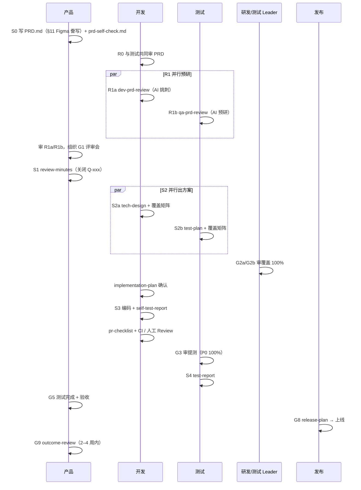
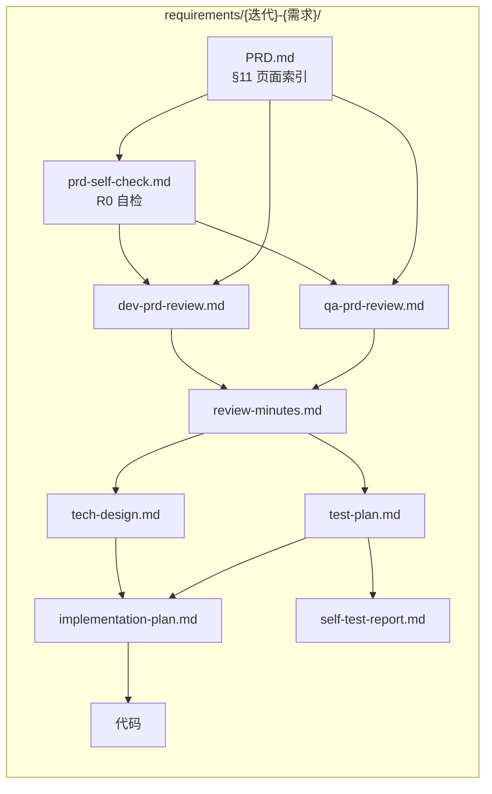

# 产研测交付 · 全流程图

> **AI Delivery Kit** **v1.0.0**  
> 铁律：**人工 checkpoint 签字** · **AI 留痕** · **Context Pack 先行**  
> **AI Delivery Hub** 以需求为协作主线；产品/研发/测试在同一需求上维护各自产物。  
> 规范：[core/lifecycle.md](../core/lifecycle.md) · checkpoint 检查表：[core/gates.md](../core/gates.md)

---

## 0. 怎么读这张图

| 符号 | 含义 |
|------|------|
| `S0`–`S5` | **阶段动作**（谁产出哪份文档） |
| `R0`、`R1a/b`、`G1`… | **门禁**（人工审核签字，不过不能进下一关） |
| `∥` | **可并行**（两边都 Pass 才能汇合） |
| 菱形 `{{}}` | 判断：Pass / 驳回修订 |
| 圆角文档框 | 产出物文件名（在 `requirements/{迭代}-{需求}/`） |

**命名提醒**：本包 **G1 = 三方需求评审会**；PDF 里的「产品发现」记为 **PDF-G1**（不是本包 G1）。

---

## 1. 全景泳道图（按角色）

下图把 **谁做什么、产出什么、过哪道 Gate** 写在节点里。从左到右是时间顺序；同一行内上下可并行。

```mermaid
flowchart TB
    subgraph UP["① 需求上游（可选，大需求建议走）"]
        direction LR
        G0["G0 Opportunity Brief<br/>产出: opportunity-brief.md<br/>负责人: 产品 · 签字: 产品负责人"]
        DG["PDF-G1 Discovery<br/>产出: discovery-report.md<br/>负责人: 产品 · 签字: 产品负责人"]
        G0 --> DG
    end

    subgraph PRD["② 需求就绪"]
        direction TB
        S0["S0 写 PRD<br/>产出: PRD.md + prd-self-check.md<br/>负责人: 产品<br/>Must: US/AC/BE/NFR/CL ID<br/>有 UI: Figma AI + §11 页面索引<br/>自检: Fail/Partial 解释充分"]
        R0{{"R0 审 PRD<br/>签字: 研发负责人 + 测试负责人<br/>硬门槛: AC 可测 · §11 非空 · 自检充分"}}
        S0 --> R0
    end

    subgraph PRE["③ 评审前预研（R0 后 1 工作日内，并行）"]
        direction LR
        R1a["R1a 开发 AI 预研<br/>产出: dev-prd-review.md<br/>负责人: 开发主程<br/>Must: Q≥5 · 有解释/影响/建议"]
        R1b["R1b 测试 AI 预研<br/>产出: qa-prd-review.md<br/>负责人: 测试主测<br/>Must: Q≥5 · 可测性分析 · 有改进建议"]
        R1chk{{"R1 双 Pass?<br/>R1a: 产品签字<br/>R1b: 产品+测试签字"}}
        R1a --> R1chk
        R1b --> R1chk
    end

    subgraph REV["④ 需求评审会"]
        G1m{{"G1 三方评审会<br/>产出: review-minutes.md<br/>签字: 产品+开发+测试<br/>硬门槛: 预研 Q-xxx 全部 Close"}}
    end

    subgraph DESIGN["⑤ 方案并行（G1 后 1 工作日内）"]
        direction LR
        S2a["S2a 技术方案<br/>产出: tech-design.md<br/>负责人: 开发<br/>Must: §10 PRD 覆盖矩阵 100%"]
        S2b["S2b 测试方案<br/>产出: test-plan.md<br/>负责人: 测试<br/>Must: §8 PRD 覆盖矩阵 100% · 边界用例"]
        G2a{{"G2a 审技术方案<br/>签字: 研发 Leader<br/>Skill: tech-design-coverage-review"}}
        G2b{{"G2b 审测试方案<br/>签字: 测试 Leader + 产品<br/>Skill: test-plan-coverage-review"}}
        S2a --> G2a
        S2b --> G2b
        G2join{{"G2 双 Pass?<br/>Gap=0 方可编码"}}
        G2a --> G2join
        G2b --> G2join
    end

    subgraph CODE["⑥ 编码执行"]
        PLAN3["实现计划<br/>产出: implementation-plan.md<br/>负责人: 开发 Owner<br/>铁律: plan 确认后才开始改代码"]
        S3["S3 编码 + 自测<br/>产出: 代码 + self-test-report.md<br/>负责人: 开发<br/>Must: P0 TC 覆盖 100% + 证据"]
        PRC["PR 准备<br/>产出: pr-checklist.md<br/>CI + 扫描 + 人工 Review"]
        G3{{"G3 提测准入<br/>签字: 测试负责人<br/>Skill: self-test-coverage-check<br/>4 工作小时内"}}
        PLAN3 --> S3 --> PRC --> G3
    end

    subgraph TEST["⑦ 测试与验收"]
        S4["S4 执行测试<br/>产出: test-report.md<br/>负责人: 测试"]
        S5["S5 产品验收<br/>产出: acceptance-record.md<br/>负责人: 产品"]
        G5{{"G5 验收准出<br/>签字: 产品负责人 + 研发负责人 + 测试负责人<br/>P0 100% Pass · CL Fail=0"}}
        S4 --> S5 --> G5
    end

    subgraph SHIP["⑧ 发布与复盘"]
        direction TB
        G8["G8 发布计划<br/>产出: release-plan.md<br/>负责人: 发布负责人<br/>灰度 · 回滚 · 监控"]
        REL["上线"]
        G9["G9 复盘<br/>产出: outcome-review.md<br/>负责人: 产品 · 上线后 2–4 周"]
        G8 --> REL --> G9
    end

    UP --> PRD
    R0 --> PRE
    R1chk -->|Pass| REV
    R1chk -->|驳回| R1a
    G1m --> DESIGN
    G2join -->|Pass| CODE
    G2join -->|驳回| S2a
    G3 -->|Pass| TEST
    G3 -->|驳回| S3
    G5 --> SHIP
    G9 -.->|知识回流| G0
```



**串行口诀**（记不住图时看这句）：

```
G0→PDF-G1→S0→R0→(R1a∥R1b)→G1→(S2a∥S2b)→G2→implementation-plan→S3→pr-checklist→G3→S4→S5→G5→G8→上线→G9
```

---

## 2. 阶段详解（逐关说明）

### 2.1 需求上游（大需求 / 新方向建议走）

| 阶段 | 产出 | 谁写 | 谁签字 | 过关意味着什么 |
|------|------|------|--------|----------------|
| **G0** | `opportunity-brief.md` | 产品 | 产品负责人 | 问题真实、有证据、值得做 |
| **PDF-G1** | `discovery-report.md` | 产品 | 产品负责人 | 痛点量化、方案对比完成 |

小需求可跳过，直接从 **S0 写 PRD** 进入交付主线。

### 2.2 需求就绪 → 评审（R0 前禁止开 G1 会）

| 阶段 | 产出 | 谁写 | 谁签字 | 硬门槛 |
|------|------|------|--------|--------|
| **S0** | `PRD.md` + `prd-self-check.md` | 产品 | — | US/AC/BE/NFR/CL 有 ID；有 UI 时 §11 页面索引（非仅 Figma 链接）；自检指出 Fail/Partial 的解释与改进方向 |
| **R0** | 审 PRD + 自检报告 | — | 研发负责人 + 测试负责人 | AC 可测试；§8 埋点；§9 灰度（中高风险）；自检解释充分 |
| **R1a** ∥ **R1b** | `dev-prd-review.md` / `qa-prd-review.md` | 开发 / 测试 | 产品 / 产品+测试 | 摘要≥200 字；**Q≥5**；Q 有解释/影响/改进建议；禁止「暂无问题」 |
| **G1** | `review-minutes.md` | 产品 | 产品+开发+测试 | 会上关闭全部预研 **Q-xxx** |

> **常见误区**：没做 R1a/R1b 就开 G1 → 直接驳回。R1 是 G1 的前置条件，不是可选项。

### 2.3 方案 → 编码（G2 不过不能写代码）

| 阶段 | 产出 | 谁写 | 谁签字 | 硬门槛 |
|------|------|------|--------|--------|
| **S2a** ∥ **S2b** | `tech-design.md` / `test-plan.md` | 开发 / 测试 | — | 各自 PRD 覆盖矩阵 **100%**，Gap=0 |
| **G2a** / **G2b** | 审方案 | — | 研发 Leader / 测试 Leader+产品 | spot check；边界用例；方案改动点有回归 |
| **implementation-plan** | `implementation-plan.md` | 开发 Owner | 开发 Owner | **先确认 plan，再动代码** |
| **S3** | 代码 + `self-test-report.md` | 开发 | — | 每个 P0 TC：Pass + 截图/日志 |
| **PR 准备** | `pr-checklist.md` | 代码 Owner | 代码 Owner + Reviewer | CI 绿；人工 Review |
| **G3** | 提测准入 | — | 测试负责人 | P0 自测覆盖 **100%** |

### 2.4 测试 → 上线 → 复盘

| 阶段 | 产出 | 谁写 | 谁签字 | 硬门槛 |
|------|------|------|--------|--------|
| **S4** | `test-report.md` | 测试 | — | 按 test-plan 执行 |
| **S5** | `acceptance-record.md` | 产品 | — | spot check 关键 CL |
| **G5** | 验收准出 | — | 产品负责人 + 研发负责人 + 测试负责人 | P0 100% Pass；无 open Block；CL Fail=0 |
| **G8** | `release-plan.md` | 发布负责人 | 发布负责人 | 灰度策略 + 回滚步骤 |
| **上线** | — | 发布 | — | 按 release-plan 执行 |
| **G9** | `outcome-review.md` | 产品 | 产品 | 指标对比 PRD §1/§8；知识入库 |

---

## 3. 交付主线时序图（看先后关系）



---

## 4. Context Pack 与 Agent 可读链

每个需求一个目录，Agent 按顺序读，避免「只给 PRD 就让写代码」：



| 你想让 AI 做… | 最少要 @ 这些文件 |
|---------------|-------------------|
| R0 自检 PRD | `PRD.md` + §11 描述 + 原型/原始材料 |
| 挑刺 PRD（R1） | `PRD.md` + `prd-self-check.md` + §11 描述 |
| 写技术方案（S2a） | `PRD.md` + `review-minutes.md` + 代码路径 |
| 写测试方案（S2b） | `PRD.md` + `review-minutes.md` + `tech-design.md` |
| 写实现计划（G3） | `PRD.md` + `tech-design.md` + `test-plan.md` |
| 查自测覆盖（G3） | `test-plan.md` + `self-test-report.md` |

详见 [core/ai-friendly.md](../core/ai-friendly.md) · [context-pack/README.md](../context-pack/README.md)。

---

## 5. 产出物 · Gate · 硬门槛 速查

| 产出 | 阶段 | Gate | 硬门槛 |
|------|------|------|--------|
| `opportunity-brief.md` | G0 | G0 | 问题有证据 |
| `discovery-report.md` | PDF-G1 | PDF-G1 | 指标与替代方案 |
| `PRD.md` | S0 | R0 | §11 原型；AC 可测 |
| `prd-self-check.md` | R0 前 | R0 | Fail/Partial 有证据、解释、影响、改进方向 |
| `dev-prd-review.md` | R1a | R1a | Q≥5；有解释/影响/建议 |
| `qa-prd-review.md` | R1b | R1b | Q≥5；有解释/影响/建议 |
| `review-minutes.md` | S1 | G1 | Q 全部 Close |
| `tech-design.md` | S2a | G2a | §10 覆盖 100% |
| `test-plan.md` | S2b | G2b | §8 覆盖 100% |
| `implementation-plan.md` | G3 | G3 | plan 后编码 |
| `self-test-report.md` | S3 | G3 | P0 100% + 证据 |
| `test-report.md` | S4 | G5 | P0 Pass |
| `acceptance-record.md` | S5 | G5 | CL Fail=0 |
| `pr-checklist.md` | PR 准备 | G3 | CI + 人审 |
| `release-plan.md` | G8 | G8 | 灰度回滚 |
| `outcome-review.md` | G9 | G9 | 指标对比 |

---

## 6. AI Skills 挂载点

| 阶段 | Must/建议 | Skill / Prompt |
|------|-----------|----------------|
| R0 自检 | 建议 | `prompts/R0-prd-self-check.md` |
| R1a/R1b | **Must** | `prd-prototype-challenge` |
| S0–S5 起草 | Must | `delivery-gate-docs` + 对应 `prompts/S*.md` |
| G2a 审核 | 建议 | `tech-design-coverage-review` |
| G2b 审核 | 建议 | `test-plan-coverage-review` |
| implementation-plan | **Must** | `prompts/G3-implementation-plan.md` |
| G3 提测 | **Must** | `self-test-coverage-check` |
| 任意 Gate 预检 | 建议 | `prompts/gate-review.md` |

安装：`./install.sh`

---

## 7. 时限与并行（排期用）

| 节点 | 提交时限 | 审核时限 |
|------|----------|----------|
| R0 | PRD 完成即提 | 1 工作日 |
| R1a/R1b | R0 Pass 后 **1 工作日** | 各 1 工作日 |
| G1 纪要 | 会后 | **4 小时** |
| S2a/S2b | G1 后 **1 工作日** | G2 各 1 工作日 |
| G3 提测 | 开发完成即提 | **4 工作小时** |

并行规则：

- **R1a ∥ R1b**：两边都 Pass 才能开 G1
- **S2a ∥ S2b**：G2a 且 G2b 都 Pass 才能进编码执行
- G2b 未过：**不得提测**（测试可维护用例，但不接受 G3）

---

## 8. 相关

- 按角色干什么：[quick-start-by-role.md](quick-start-by-role.md)
- Cursor 实操：[cursor-guide.md](cursor-guide.md)
- 宣贯一页纸：[confluence-one-pager.md](confluence-one-pager.md)
- 完整 Gate 检查表：[core/gates.md](../core/gates.md)
