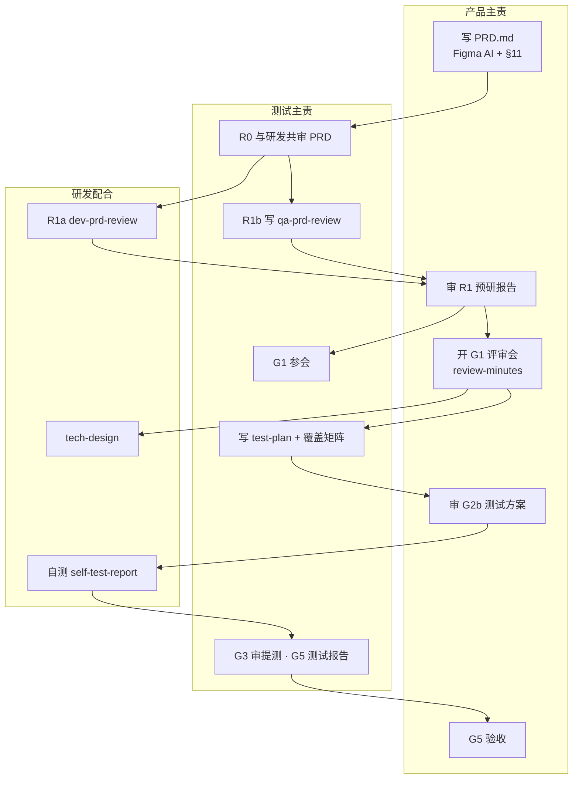

# 产研测新开发流程 · 产品 & 测试沟通材料

> **版本**：AI Delivery Kit v1.0.0  
> **读者**：产品、测试（研发可参考配合节奏）  
> **用途**：评审会宣贯、迭代启动对齐、日常执行对照  
> **详细流程图**：[lifecycle.md](./lifecycle.md) · **Confluence**：[Hub](https://confluence.example.com/spaces/TEAM/pages/1001/)

---

## 一、为什么要改（30 秒版）

| 过去常见问题 | 新流程怎么解决 |
|--------------|----------------|
| PRD 评审会上才发现歧义、漏项 | **G1 前先让 AI+研发/测试预研**，问题书面化（Q-xxx），会上只关问题 |
| 方案和用例与 PRD 对不上 | **覆盖矩阵 100%**，G2 不过不能开发 |
| 提测质量不稳、反复打回 | **P0 用例开发必须自测并附证据**，G3 测试 4 小时内审核 |
| AI 用了但说不清谁审的 | **每关人工签字** + B 级 AI 产出留痕 |

**核心观念**：AI 帮忙出草稿和挑刺，**人不能甩锅**——每一关仍要负责人签字过关。

---

## 二、三条铁律（务必记住）

1. **人工 Gate 签字**：R0、R1、G1、G2、G3… 每一关有明确签字人；口头同意不算数。  
2. **文档结构化**：PRD / 测试方案用统一 ID（US、AC、TC、Q-xxx），方便人和 AI 对齐。  
3. **有 UI 必须双轨**：Figma AI 出原型 + PRD **§11 页面索引誊写**（编码和 Agent 只读 Markdown，不直连 Figma）。

---

## 三、全流程（产品 & 测试视角）



**串行口诀**：

```
产品写 PRD → R0(研发+测试审) → R1预研(开发∥测试) → G1评审会 → 方案(开发∥测试) → G2 → 开发编码自测 → G3提测 → 测试 → G5 → 产品验收 G5 → 上线 → 复盘
```

更细的泳道图、驳回回路、时限见 [lifecycle.md](./lifecycle.md)。

---

## 四、按时间线：产品要做什么

| 顺序 | 时机 | 你做什么 | 产出文件 | 过关 Gate | 签字人 |
|:----:|------|----------|----------|-----------|--------|
| 1 | 迭代初 | 写需求文档；有界面用 Figma AI，并**誊写 §11 页面索引** | `PRD.md` | **R0** | 研发负责人 + 测试负责人审（你不签 R0，但要配合改） |
| 2 | R0 通过后 1 日内 | 审开发、测试的预研报告是否认真 | 审 `dev-prd-review.md`、`qa-prd-review.md` | **R1a / R1b** | **你签 R1a**；R1b 你与测试负责人共签 |
| 3 | R1 双通过后 | 开三方评审会，**关闭全部 Q-xxx** | `review-minutes.md` | **G1** | 产品 + 开发 + 测试 |
| 4 | G1 后 | 参与审测试方案（覆盖是否够、AC 是否有 P0 用例） | 审 `test-plan.md` | **G2b** | 你与测试 Leader 共签 |
| 5 | 测试完成后 | spot check 验收记录 | `acceptance-record.md` | **G5** | 产品负责人 + 研发负责人 |
| 6 | 上线后 2–4 周 | 写复盘（可选试点期强制） | `outcome-review.md` | **G9** | 产品 |

### PRD 最低要求（R0 必查）

| 项 | 要求 |
|----|------|
| 用户故事 / 验收标准 | 每条 US 至少 1 条**可测试** AC，带 ID |
| 边界 | BE ≥5 条或标明 N/A |
| 有指标 | **§8 埋点**非空 |
| 中高风险 | **§9 灰度**非空 |
| 有界面 | **§11** 含 Figma 链接 + **PG-xxx 页面索引**（组件、状态、跳转） |
| 禁止 | 只有 Figma 链接、没有 §11 文字说明 |

### 审 R1 预研报告时看什么（驳回标准）

| 检查 | 通过 |
|------|------|
| 摘要 | ≥200 字，且不是 PRD 复制粘贴 |
| 问题数 | ≥5 条，编号 Q-001…，引用 US/AC/页面 |
| 态度 | 禁止「暂无问题」「无明显风险」敷衍 |
| 原型 | 有 UI 时，报告里引用了 §11 页面，不是只贴链接 |

---

## 五、按时间线：测试要做什么

| 顺序 | 时机 | 你做什么 | 产出文件 | 过关 Gate | 签字人 |
|:----:|------|----------|----------|-----------|--------|
| 1 | PRD 完成后 | 与研发负责人**共审 PRD**（可测性、AC、§11） | 审 `PRD.md` | **R0** | 测试负责人 + 研发负责人 |
| 2 | R0 通过后 1 日内 | **必做** AI 预研 PRD+原型（测试视角） | `qa-prd-review.md` | **R1b** | 产品 + **你（测试负责人）** |
| 3 | R1 通过后 | 参加 G1，确认预研问题已关闭 | 参会 | **G1** | 三方 |
| 4 | G1 后 1 日内 | 写测试方案 + **PRD 覆盖矩阵 100%** | `test-plan.md` | **G2b** | 测试 Leader + 产品 |
| 5 | 开发提测 | 审自测是否覆盖全部 **P0** 用例、证据是否真实 | 审 `self-test-report.md` | **G3** | **测试负责人**（4 工作小时内） |
| 6 | 执行测试 | 按 test-plan 执行 | `test-report.md` | **G5** | 测试 + 产品 |
| 7 | G2b 未过时 | 可维护用例，但**不接受提测** | — | — | — |

### test-plan 最低要求（G2b 必查）

| 项 | 要求 |
|----|------|
| PRD 覆盖矩阵 | 每条 US/AC/BE/NFR 有 TC 映射，**覆盖率 100%**，Gap=0 |
| P0 | 每条 AC 至少 1 条 P0 用例 |
| 边界 | 空值、边界值、权限、重复提交、超时失败等（见 [boundaries.md](../core/boundaries.md)） |
| 方案联动 | tech-design 改动点在 test-plan 有回归/对应用例 |

### G3 提测审核看什么

| 检查 | 通过 |
|------|------|
| P0 覆盖 | self-test-report 中 P0 TC 覆盖率 **= 100%** |
| 证据 | 每条 P0 Pass 有截图或日志链接，不能空填 |
| 一致性 | 自测 TC ID 与 test-plan 一致 |

---

## 六、评审会（G1）怎么开

**前置条件（缺一不开会）**：

- [ ] R0 已通过  
- [ ] `dev-prd-review.md`、`qa-prd-review.md` 已提交且 R1a/R1b 已签字  
- [ ] 两份预研报告问题均 ≥5 条  

**会上必做**：

1. 过一遍 **Q-001…Q-00N**，当场定：Close / 转 PRD 修改 / 转后续 Story  
2. 确认范围、排期、In/Out Scope  
3. 会后 4 小时内产出 `review-minutes.md`，**所有 Q-xxx 状态为 Close** 才算 G1 Pass  

**会后**：开发写技术方案、测试写测试方案（**并行**，各 1 工作日）。

---

## 七、签字责任一览

| Gate | 审什么 | 谁签字 |
|------|--------|--------|
| **R0** | PRD 完整、AC 可测、§11 | 研发负责人 + 测试负责人 |
| **R1a** | 开发预研报告 | **产品** |
| **R1b** | 测试预研报告 | **产品 + 测试负责人** |
| **G1** | 评审纪要、Q 关闭 | 产品 + 开发 + 测试 |
| **G2b** | 测试方案覆盖 100% | 测试 Leader + **产品** |
| **G3** | 开发自测 P0 100% | **测试负责人** |
| **G5** | 测试报告 P0 Pass | 测试 + **产品** |
| **G5** | 验收 CL | 产品负责人 + 研发负责人 |

产品、测试在流程中**签字节点最多**——新流程不是加重文档负担，而是把「评审前该想清楚的事」前置到 R1，会上只决策。

---

## 八、需求文件夹（每个需求一份）

业务/项目仓库内路径（与代码同仓或关联仓）：

```
requirements/{迭代}-{需求简称}/
├── PRD.md                 ← 产品
├── dev-prd-review.md      ← 开发（G1 前）
├── qa-prd-review.md       ← 测试（G1 前）
├── review-minutes.md      ← 产品（G1 后）
├── tech-design.md         ← 开发
├── test-plan.md           ← 测试
├── self-test-report.md    ← 开发（提测）
├── test-report.md         ← 测试
├── acceptance-record.md   ← 产品
├── release-plan.md        ← 发布
└── outcome-review.md      ← 产品（复盘）
```

模板均在 `ai-delivery-kit/artifacts/templates/`，**不要自创格式**。

---

## 九、和研发的配合节奏（产品/测试需知）

| 节点 | 研发动作 | 对产品/测试的影响 |
|------|----------|-------------------|
| R0 后 1 日 | 开发出 dev-prd-review | 产品审 R1a；测试并行出 qa-prd-review |
| G1 后 1 日 | 开发出 tech-design | 测试出 test-plan，需对齐 tech-design 改动点 |
| G2 通过后 | 开发先写 implementation-plan | **G2 不过，研发不能开写代码** |
| 提测 | 开发交 self-test-report | 测试 G3 审核，不过则打回、不算进入 S4 |

---

## 十、直接驳回的情形（敷衍清单）

| 情形 | 谁的责任 | 处理 |
|------|----------|------|
| 没做 R1 就开 G1 | 全体 | 会不开，补预研报告 |
| 预研「暂无问题」或 Q<5 | 开发/测试 | R1 驳回，24h 内重提 |
| PRD 只有 Figma 无 §11 | **产品** | R0 不通过 |
| test-plan 覆盖 Gap>0 | **测试** | G2b 不通过 |
| P0 标 Pass 无截图/日志 | 开发 | G3 不通过（测试负责拦） |
| 口头说「可以提测」无 G3 签字 | 测试 | 不得开始正式 S4 测试 |

---

## 十一、AI / Cursor 怎么用（产品 & 测试）

不要求人人会写代码，但**会用 Cursor 读文档、出草稿**能省时间：

| 角色 | 场景 | 复制到 Cursor |
|------|------|---------------|
| 产品 | 起草 PRD | `按 delivery-gate-docs skill 生成 S0 PRD，素材：…` |
| 产品 | 审开发预研 | `按 gate-review 预检 @dev-prd-review.md 对照 @PRD.md` |
| 测试 | **G1 前必做** | `按 prd-prototype-challenge skill（测试视角）阅读 @PRD.md，生成 qa-prd-review.md` |
| 测试 | 写测试方案 | `按 delivery-gate-docs skill 生成 S2b 测试方案 @PRD.md @review-minutes.md @tech-design.md` |
| 测试 | 审提测 | `按 self-test-coverage-check skill 审核 @self-test-report.md @test-plan.md` |

研发侧安装 Skills（产品/测试也可装，便于自己跑预检）：

```bash
cd ai-delivery-kit && ./install.sh
```

更多命令见 [cursor-guide.md](./cursor-guide.md)。

---

## 十二、常见问题

**Q：文档变多了，是不是更慢？**  
A：首迭代 R1/G2 可能多 1–2 轮驳回；第二迭代起，提测打回应减少。试点会采基线对比。

**Q：小需求也要全套吗？**  
A：交付主线（PRD→R1→G1→方案→测试→验收）不变；G0/PDF-G1 上游可省略。文档可薄，但**Gate 和 ID 不能省**。

**Q：PRD 在 Confluence，还要 PRD.md 吗？**  
A：要。`requirements/…/PRD.md` 是 Context Pack 权威源，给 AI 和研发测试对齐用；可与 Confluence 同步，但**以 Markdown 为准**。

**Q：Figma 已经给链接了，为什么还要 §11？**  
A：Agent 和编码环节不直连 Figma；§11 是把原型「翻译」成可检索的文字+页面 ID，避免实现跑偏。

**Q：测试方案谁批？产品要看到什么？**  
A：G2b 由测试 Leader + 产品共签。产品重点看：每条 AC 是否有 P0、边界类是否覆盖、与 PRD 文案/规则是否一致。

---

## 十三、试点建议（沟通时可对齐）

| 项 | 建议 |
|----|------|
| 试点范围 | 选 1 个产品 + 对应研发/测试小组，2 个需求走完全链路 |
| 第一周 | 只盯 R0、R1、G1 三件事做对 |
| 负责人 | 明确 R0/G1/G2b/G3/G5 签字人（见第七节） |
| 检查清单 | [pilot-90day-checklist.md](./pilot-90day-checklist.md) |

---

## 十四、延伸阅读

| 文档 | 用途 |
|------|------|
| [lifecycle.md](./lifecycle.md) | 完整泳道图 + 时限 |
| [confluence-one-pager.md](./confluence-one-pager.md) | 按角色一页纸 |
| [core/gates.md](../core/gates.md) | Gate 完整检查表 |
| [core/ai-friendly.md](../core/ai-friendly.md) | PRD/用例怎么写 AI 才读得懂 |

---

**会后行动项（建议当场勾选）**

- [ ] 确认本迭代试点需求目录 `requirements/{迭代}-{需求}/`  
- [ ] 确认 R0/R1/G1/G2b/G3 签字人姓名  
- [ ] 产品补充 PRD 模板与 §11 示例  
- [ ] 测试补充 test-plan 覆盖矩阵示例  
- [ ] 约定第一次 G1 日期（须在 R1 双 Pass 之后）
